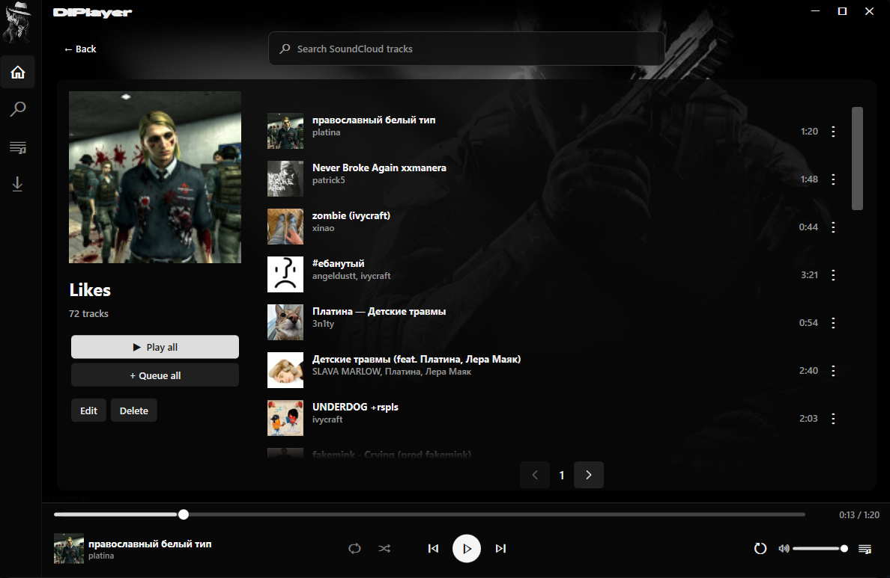
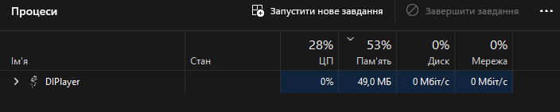
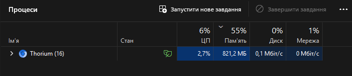

<div align="center">


# DIPlayer

**Most optimizing player for Desktop. From Gamer. For Gamers.**

**A SoundCloud player, designed to keep resource use low while you play.**

A standalone Windows app with a dark interface, local playlists and a compact mini player.

[](https://github.com/GeekyKrank/DIPlayer/releases/download/v0.3.0-alpha/DIPlayer-Setup-0.3.0-alpha-x64.exe) [](https://github.com/GeekyKrank/DIPlayer/releases/tag/v0.3.0-alpha)

[Portable ZIP](https://github.com/GeekyKrank/DIPlayer/releases/download/v0.3.0-alpha/DIPlayer-win-x64.zip) · [All releases](https://github.com/GeekyKrank/DIPlayer/releases) · [Report an issue](https://github.com/GeekyKrank/DIPlayer/issues)

</div>

---



### Made for listening

| | What you get |
| :--- | :--- |
| **Find & play** | SoundCloud search, single-click playback and precise seek/volume controls. |
| **Your library** | SoundCloud account import with Likes, custom covers, table view and creation-date sorting. |
| **Your queue** | Reorder, remove and queue tracks — or clear the list in one click. |
| **Stay compact** | A top-center mini player, tray playback and Windows media keys. |

<div align="center">

</div>

### A small footprint

<table>
<tr><th align="left">DIPlayer — standalone music player</th></tr>
<tr><td></td></tr>
<tr><th align="left">Thorium — optimized browser with one SoundCloud tab</th></tr>
<tr><td></td></tr>
</table>

User-provided Task Manager snapshots: **49.0 MB** for DIPlayer and **821.2 MB** for the Thorium process group. The browser had one SoundCloud tab open. These are individual snapshots; usage varies with playback, workload and configuration.

### Get started

1. **Install** using the EXE above, or extract the entire portable ZIP. No separate .NET installation needed.
2. **Search** for a track or import a public playlist. Optionally sign in to import your playlists and Likes.
3. **Listen.** Press **—** for the mini player; double-click its title to return. Use **Quit** in the tray to exit.

**Updating?** Quit DIPlayer, then run the new installer over the existing installation. Your playlists and covers stay saved.

### A few things to know

- Tested on **Windows 11 x64**. This is an unsigned alpha; automatic updates are not included.
- Internet and the shared catalog are required. Some SoundCloud tracks are unavailable to external players; private playlists and access restrictions are not bypassed.
- Audio uses bounded streaming buffers. Earlier measurements are documented; the current version has **not** completed a new one-hour RAM/CPU run.

### Explore the project

[Full guide & build instructions](docs/guide.md) · [Performance & validation](docs/validation.ru.md) · [Catalog server](docs/server.ru.md) · [API investigation](docs/feasibility.ru.md)

<details>
<summary><strong>Build it yourself</strong></summary>

Windows + .NET 10 SDK:

```powershell
pwsh -File tools/Build.ps1 -WindowsRid win-x64
```

For the EXE installer, install Inno Setup 6 or 7 and run `pwsh -File tools/Build-Installer.ps1`.

</details>

---

<sub>Independent project, not affiliated with SoundCloud. API terms and shared-service limits apply. [Third-party notices](THIRD_PARTY_NOTICES.md) · [Artwork & font credits](src/DIPlayer/Assets/NOTICE.md)</sub>
