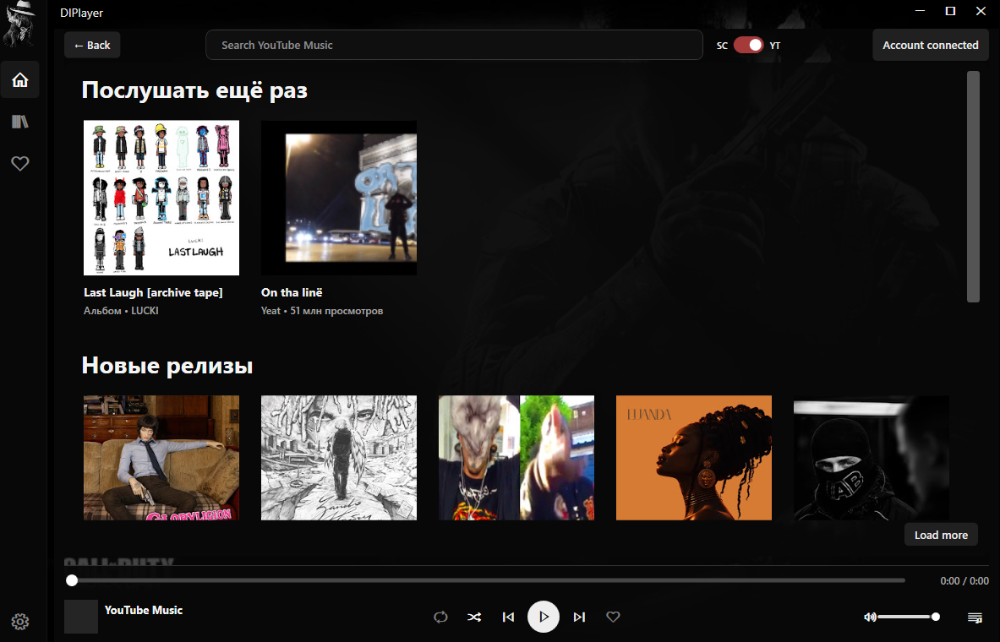
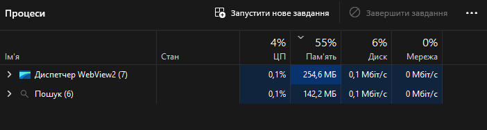

<div align="center">


# DIPlayer

**From a gamer. For gamers.**

**A lightweight SoundCloud player with an optional YouTube Music mode.**

A Windows music player built for gaming: native controls, separate service libraries and a compact mini player. Switch between SC and YT beside search.

[](https://github.com/GeekyKrank/DIPlayer/releases/download/v0.4.0-alpha/DIPlayer-Setup-0.4.0-alpha-x64.exe) [](https://github.com/GeekyKrank/DIPlayer/releases/tag/v0.4.0-alpha)

[Portable ZIP](https://github.com/GeekyKrank/DIPlayer/releases/download/v0.4.0-alpha/DIPlayer-win-x64.zip) · [All releases](https://github.com/GeekyKrank/DIPlayer/releases) · [Report an issue](https://github.com/GeekyKrank/DIPlayer/issues)

</div>

---


### YouTube Music, in DIPlayer



Large cover cards, personal recommendations, new releases, albums, Likes and queue — all in DIPlayer's interface. Albums open as collections; one-track singles play immediately. Sign in through Google, then return to the native player. The compact **SC / YT** switch changes service; each keeps its own library.

### Made for listening

| | What you get |
| :--- | :--- |
| **Find & play** | SoundCloud and YouTube Music search, cover cards and precise seek/volume controls. |
| **Your library** | SoundCloud account import with Likes, custom covers, table view and creation-date sorting. |
| **Your queue** | Repeat, shuffle and clear the queue; YouTube queue access sits in the lower-right corner. |
| **Stay compact** | A top-center mini player, tray playback and Windows media keys. |

<div align="center">

</div>

### A small footprint

<table>
<tr><th align="left">DIPlayer — optimized SoundCloud mode</th></tr>
<tr><td></td></tr>
<tr><th align="left">Thorium — optimized browser with one SoundCloud tab</th></tr>
<tr><td></td></tr>
<tr><th align="left">DIPlayer YouTube mode — WebView2 component</th></tr>
<tr><td></td></tr>
</table>

| Snapshot | Memory | Compared with the other modes |
| :--- | ---: | :--- |
| **DIPlayer · SoundCloud** | **49.0 MB** | **16.8× less** than the browser snapshot |
| **DIPlayer · YouTube Music** | **330.6 MB total** | **6.7× more** than SoundCloud mode; **2.5× less** than the browser snapshot |
| **Thorium · one SoundCloud tab** | **821.2 MB** | Browser process group |

YouTube total = **76 MB DIPlayer + 254.6 MB WebView2**. The 76 MB host-process value was supplied by the user alongside the capture; the separate Windows Search row is excluded. These are user snapshots from separate runs, not a controlled benchmark or an FPS guarantee.

Thorium had one SoundCloud tab open. Memory use varies with playback, workload and configuration.

### Get started

1. **Install** using the EXE above, or extract the entire portable ZIP. No separate .NET installation needed.
2. **Choose SC or YT.** Search for music; in SoundCloud mode, import playlists or sign in to copy playlists and Likes. YouTube mode uses its own Google account library.
3. **Listen.** Press **—** for the mini player; double-click its title to return. Use **Quit** in the tray to exit.

**Updating?** Quit DIPlayer, then run the new installer over the existing installation. Your playlists and covers stay saved.

### A few things to know

- Tested on **Windows 11 x64**. This is an unsigned alpha; a button links to new GitHub releases; installation remains manual.
- SoundCloud uses the shared catalog. Some tracks are unavailable to external players; access restrictions are not bypassed.
- YouTube Music mode requires Microsoft Edge WebView2 Runtime and uses additional browser processes. It includes uBO Lite filtering; complete ad removal is not guaranteed. Google sign-in and content availability depend on YouTube.
- Audio uses bounded streaming buffers. Earlier measurements are documented; the current version has **not** completed a new one-hour RAM/CPU run.

### Explore the project

[YouTube mode](docs/browser-mode.md) · [Full guide & build instructions](docs/guide.md) · [Performance & validation](docs/validation.ru.md) · [Catalog server](docs/server.ru.md) · [API investigation](docs/feasibility.ru.md)

<details>
<summary><strong>Build it yourself</strong></summary>

Windows + .NET 10 SDK:

```powershell
pwsh -File tools/Build.ps1 -WindowsRid win-x64
```

For the EXE installer, install Inno Setup 6 or 7 and run `pwsh -File tools/Build-Installer.ps1`.

</details>

---

<sub>Independent project, not affiliated with SoundCloud, YouTube or Google. API terms and shared-service limits apply. [Third-party notices](THIRD_PARTY_NOTICES.md) · [Artwork & font credits](src/DIPlayer/Assets/NOTICE.md)</sub>
